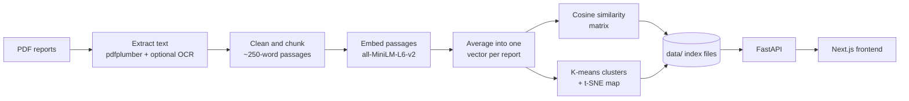

# RELIC

**The past leaves clues. RELIC finds the connections.**

RELIC reads archaeological excavation reports, measures how closely their wording matches, and groups the sites that read alike. It helps a researcher decide which reports are worth reading side by side.

It turns a research notebook (PDF text extraction, sentence embeddings, cosine similarity, clustering) into a working application: a **FastAPI** backend that serves the analysis and a **Next.js** frontend for exploring it.

> **Textual similarity is not proof.** RELIC compares how reports are *written*. A high score marks a pair worth investigating; it does not establish a historical or archaeological connection.

## Features

| Page | What it does |
| --- | --- |
| **Landing** | Topographic hero with archive statistics and plotted survey points |
| **Overview** | Reports analyzed, relationships, clusters, similarity histogram, cluster sizes, and strongest pairs |
| **Archive** | Searchable, sortable, filterable reports with cluster tags and distinctive terms |
| **Analyze** | Upload a PDF and find the closest archived reports and nearest cluster |
| **Connections** | Interactive similarity network with a minimum-score slider and clickable reports |
| **Clusters** | Scatter map with cluster outlines, keywords, and representative reports |
| **Compare** | Two reports side by side with scores, matching passages, shared terms, and metadata |

## How it works



1. **Extract:** Pull text from each PDF, with optional OCR for scanned pages.
2. **Clean:** Remove library stamps, OCR debris, and page numbers.
3. **Chunk:** Split reports into overlapping passages of about 250 words.
4. **Embed:** Embed each passage with `all-MiniLM-L6-v2` and average passages into one report vector.
5. **Compare:** Compute cosine similarity for every report pair.
6. **Cluster:** Run K-means on the real embeddings. Use t-SNE only for visualization and TF-IDF for keywords.

## Tech stack

- **Backend:** Python, FastAPI, sentence-transformers, scikit-learn, NumPy, pdfplumber
- **Frontend:** Next.js 15 App Router, React 19, plain CSS, hand-built SVG charts
- **Model:** [`all-MiniLM-L6-v2`](https://huggingface.co/sentence-transformers/all-MiniLM-L6-v2)

## Project structure

```text
relic/
├── backend/
│   ├── app/
│   │   ├── main.py
│   │   └── nlp.py
│   ├── build_index.py
│   └── requirements.txt
└── frontend/
    ├── app/
    ├── components/
    ├── lib/
    └── package.json
```

## Getting started

**Requirements:** Python 3.10+, Node.js 18+, and a folder of excavation report PDFs.

### 1. Backend

```powershell
cd backend
python -m venv .venv
.venv\Scripts\Activate.ps1
pip install -r requirements.txt

# Build the index once. The model downloads on first run.
python build_index.py --pdf-dir "path\to\your\pdfs" --out data --no-ocr

# Start the API
uvicorn app.main:app --port 8000
```

Interactive API docs: <http://localhost:8000/docs>

`--no-ocr` skips OCR. PDFs with no readable text are skipped and listed in `data/metrics.json`. To process scanned PDFs, install [Tesseract](https://github.com/tesseract-ocr/tesseract) and [Poppler](https://poppler.freedesktop.org/), then rebuild without `--no-ocr`.

### 2. Frontend

```powershell
cd frontend
npm install
Copy-Item .env.local.example .env.local
npm run dev
```

Open <http://localhost:3000>. The bottom of the sidebar should read **API online** when the backend is running.

### Configuration

| Variable | Where | Default | Purpose |
| --- | --- | --- | --- |
| `NEXT_PUBLIC_API_URL` | `frontend/.env.local` | `http://localhost:8000` | API base URL used by the frontend |
| `CORS_ORIGINS` | Backend environment | `http://localhost:3000` | Comma-separated allowed origins |
| `DATA_DIR` | Backend environment | `data` | Folder containing generated index files |

## Adding titles, locations, and periods

Put a `metadata.json` file next to your PDFs, then rebuild the index. Every field is optional:

```json
{
  "39.pdf": {
    "title": "Excavations at Adam",
    "location": "Maharashtra",
    "period": "1988-1992"
  }
}
```

Cluster names are generated from keywords. To rename them, edit the `label` fields in `data/clusters.json`.

## API reference

| Method | Endpoint | Description |
| --- | --- | --- |
| `GET` | `/health` | Service status and indexed report count |
| `GET` | `/sites` | Reports with cluster, coordinates, and keywords |
| `GET` | `/sites/{id}` | One report with excerpts and nearest neighbours |
| `GET` | `/clusters` | Clusters with size, label, and keywords |
| `GET` | `/metrics` | Cluster count, silhouette score, and skipped files |
| `GET` | `/matrix` | Full similarity matrix |
| `GET` | `/similar/{id}?k=5` | Top-k similar reports |
| `GET` | `/compare?a=&b=` | Comparison score, passages, and shared keywords |
| `POST` | `/query` | Free-text semantic search over passages |
| `POST` | `/upload` | Upload a PDF and return its nearest reports and cluster |

## Limitations

- Similarity is textual and is not evidence of a historical or archaeological connection.
- Scanned PDFs need OCR to be included.
- Dates and locations appear only when supplied in `metadata.json`.
- Recently analyzed reports are stored in the browser, not on the server.
- Uploaded reports are compared against the archive but are not added to it.

## Roadmap

- Persist uploads and add them to the index
- Store embeddings in FAISS or pgvector for larger archives
- Add a chunk-level search page
- Export comparison results as a PDF brief
- Add Docker Compose setup

## Acknowledgements

Excavation reports used during development come from published archaeological survey material. Embeddings use the open-source [`all-MiniLM-L6-v2`](https://www.sbert.net/) model from the sentence-transformers project.

## License

Add a license file, such as MIT, before publishing.
