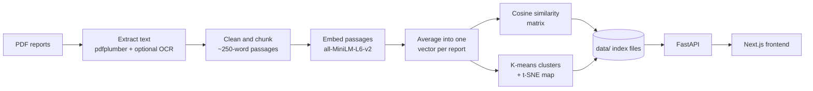

# RELIC

**The past leaves clues. RELIC finds the connections.**

RELIC reads archaeological excavation reports, measures how closely their wording matches, and groups the sites that read alike. It helps a researcher decide which reports are worth reading side by side.

It turns a research notebook (PDF text extraction, sentence embeddings, cosine similarity, clustering) into a working application: a **FastAPI** backend that serves the analysis and a **Next.js** frontend for exploring it.

> **Textual similarity is not proof.** RELIC compares how reports are *written*. A high score marks a pair worth investigating; it does not establish a historical or archaeological connection.

<!-- Add screenshots to docs/ and uncomment:


-->

## Features

| Page | What it does |
| --- | --- |
| **Landing** | Topographic hero with the live archive plotted as survey points, plus archive statistics |
| **Overview** | Reports analyzed, relationships surfaced, clusters, similarity histogram, cluster sizes, strongest pairs |
| **Archive** | Searchable, sortable, filterable list of reports with cluster tags and distinctive terms; a detail page per report |
| **Analyze** | Drag-and-drop PDF upload with progress. Returns the closest archived reports ranked by cosine similarity and the nearest cluster |
| **Connections** | Interactive similarity network. Distance reflects similarity, a slider sets the minimum score for a link, hover a line for its score, click a node for its report |
| **Clusters** | Scatter map of the clusters with outlines, keywords, and the most representative reports in each |
| **Compare** | Two reports side by side: overall score, best-matching passages with shared terms highlighted, and metadata |

## How it works



1. **Extract.** Text is pulled from each PDF. Scanned PDFs fall back to OCR if Tesseract and Poppler are installed.
2. **Clean.** Library stamps, OCR debris, and page numbers are filtered out line by line.
3. **Chunk.** Each report is split into overlapping passages of about 250 words, because the embedding model only reads about 256 tokens at a time. Embedding a whole report as one vector would only capture its first page.
4. **Embed.** Every passage is embedded with `all-MiniLM-L6-v2`. A report's vector is the average of its passages.
5. **Compare.** Cosine similarity is computed for every pair of reports.
6. **Cluster.** K-means runs on the real embeddings (not on the 2D projection), with the number of clusters chosen by silhouette score. t-SNE is used only to draw the map. TF-IDF keywords describe each report and cluster.

## Tech stack

- **Backend:** Python, FastAPI, sentence-transformers, scikit-learn, NumPy, pdfplumber
- **Frontend:** Next.js 14 (App Router), React 18, plain CSS, hand-built SVG charts
- **Model:** [`all-MiniLM-L6-v2`](https://huggingface.co/sentence-transformers/all-MiniLM-L6-v2)

## Project structure

```
relic/
├── backend/
│   ├── app/
│   │   ├── main.py          # FastAPI app and endpoints
│   │   └── nlp.py           # extraction, cleaning, chunking, embedding (shared)
│   ├── build_index.py       # run once: PDFs -> index files in data/
│   └── requirements.txt
└── frontend/
    ├── app/                 # pages: landing + (lab) routes
    ├── components/          # charts, sidebar, UI primitives
    ├── lib/                 # API client, layout and colour helpers
    └── package.json
```

## Getting started

**Requirements:** Python 3.10+, Node.js 18+, and a folder of excavation report PDFs.

### 1. Backend

```bash
cd backend
python -m venv .venv
.venv\Scripts\activate            # Windows
# source .venv/bin/activate       # macOS / Linux
pip install -r requirements.txt

# Build the index once (downloads the model on first run, takes a few minutes)
python build_index.py --pdf-dir "path/to/your/pdfs" --out data --no-ocr

# Start the API
uvicorn app.main:app --port 8000
```

- Interactive API docs: <http://localhost:8000/docs>
- `--no-ocr` skips OCR. PDFs with no readable text are skipped and listed under `skipped` in `data/metrics.json`.
- To read scanned PDFs, install [Tesseract](https://github.com/tesseract-ocr/tesseract) and [Poppler](https://poppler.freedesktop.org/), then run the build without `--no-ocr`.
- Rebuild the index whenever your PDFs or metadata change.

### 2. Frontend

```bash
cd frontend
npm install
cp .env.local.example .env.local      # Windows: copy .env.local.example .env.local
npm run dev
```

Open <http://localhost:3000>. The bottom of the sidebar should read **API online**.

### Configuration

| Variable | Where | Default | Purpose |
| --- | --- | --- | --- |
| `NEXT_PUBLIC_API_URL` | frontend `.env.local` | `http://localhost:8000` | Where the frontend finds the API |
| `CORS_ORIGINS` | backend environment | `http://localhost:3000` | Comma-separated origins allowed to call the API |
| `DATA_DIR` | backend environment | `data` | Folder holding the index files |

## Adding titles, locations, and periods

The archive shows a title, location, and period for each report when you provide them. Put a `metadata.json` next to your PDFs, then rebuild the index. Every field is optional.

```json
{
  "39.pdf": { "title": "Excavations at Adam", "location": "Maharashtra", "period": "1988-1992" }
}
```

Cluster names are generated from keywords. To rename them, edit the `label` fields in `data/clusters.json`.

## API reference

| Method | Endpoint | Description |
| --- | --- | --- |
| `GET` | `/health` | Service status and number of indexed reports |
| `GET` | `/sites` | All reports with cluster, 2D coordinates, keywords |
| `GET` | `/sites/{id}` | One report with opening excerpts and nearest neighbours |
| `GET` | `/clusters` | Clusters with size, label, and keywords |
| `GET` | `/metrics` | Cluster count, silhouette score, skipped files |
| `GET` | `/matrix` | Full similarity matrix |
| `GET` | `/similar/{id}?k=5` | Top-k most similar reports |
| `GET` | `/compare?a=&b=` | Score, shared keywords, and best-matching passages for two reports |
| `POST` | `/query` | Free-text semantic search over passages (`{"text": "...", "k": 5}`) |
| `POST` | `/upload` | Upload a PDF; returns predicted cluster and nearest reports |

## Limitations

- Similarity is **textual**. Reports can read alike because of shared vocabulary, authorship, or report format, not only because the sites are related.
- Scanned PDFs need OCR to be included, otherwise they are skipped.
- Dates and locations only appear if you supply them in `metadata.json`.
- "Recently analyzed" on the Overview page is stored in the browser, not on the server.
- Uploaded reports are compared against the archive but are not added to it.

## Roadmap

- Persist uploads and add them to the index
- Store embeddings in a vector database (FAISS or pgvector) for larger archives
- Chunk-level search page using the existing `/query` endpoint
- Export comparison results as a PDF brief
- Docker Compose setup for one-command start

## Acknowledgements

Excavation reports used during development come from published archaeological survey material. Embeddings use the open-source `all-MiniLM-L6-v2` model from the [sentence-transformers](https://www.sbert.net/) project.

## License

Add a license file (for example MIT) before publishing.